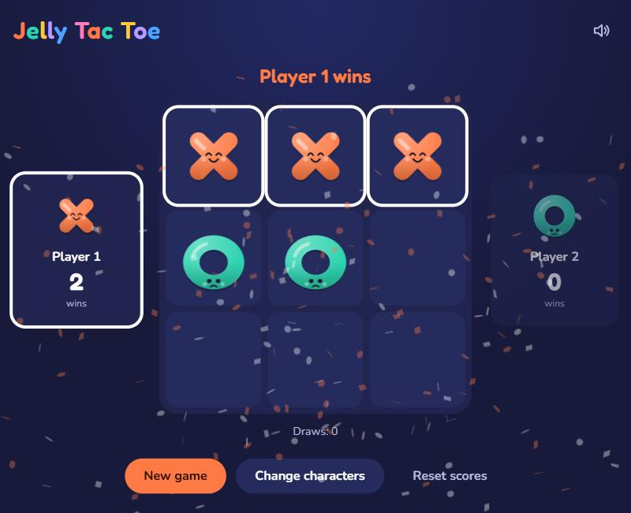
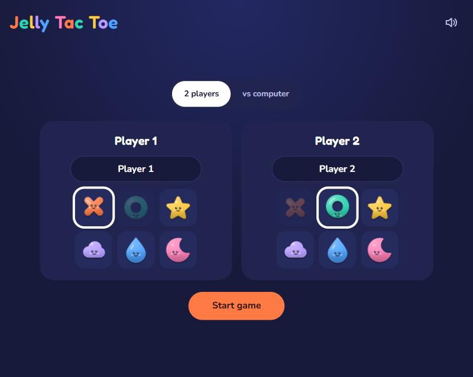
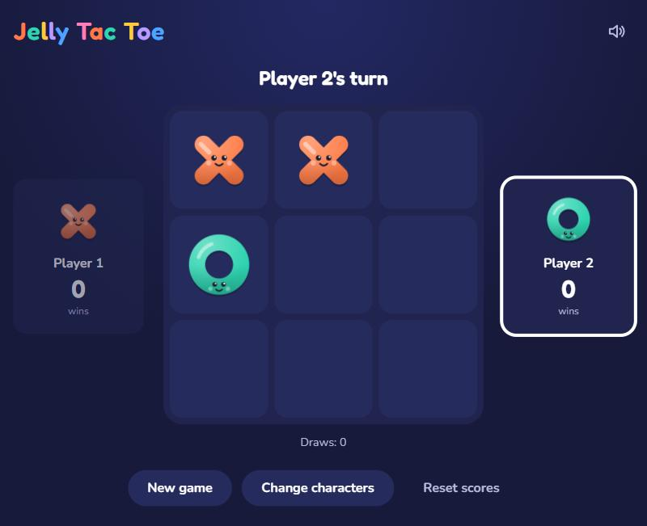
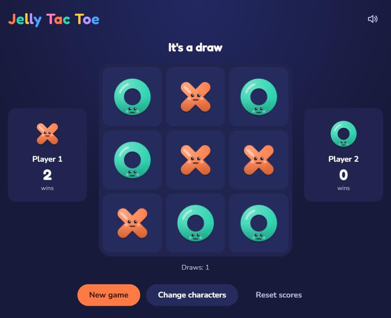

# Jelly Tac Toe

A bouncy take on Tic-Tac-Toe built with React and Next.js. Pick a character, then play a friend on one screen or take on the computer.



## How to play

**Play it live:** https://jelly-tac-toe.vercel.app

1. Choose "2 players" or "vs computer".
2. Each player types a name and picks one of six characters.
3. Take turns placing your character on the 3×3 board. Three in a row wins.
4. Press "New game" to play again. The scoreboard keeps counting wins and draws.

## Features

- Two players on one device, or one player against the computer (Easy, or a Hard level that never loses)
- Six original characters drawn in SVG, each with idle, happy, sad and shrug faces
- The game announces the winner and highlights the winning line, or announces a draw
- A scoreboard that counts wins and draws, with a reset button
- Names, characters, scores and the sound setting survive a refresh
- Sound effects generated in the browser, with a mute button
- Confetti on a win
- Playable by keyboard, with labels for screen readers and support for reduced-motion settings
- Laid out for phones first

## Screenshots

All screenshots are in the [`screenshots`](screenshots) folder.

| File | What it shows |
|---|---|
| [`01-setup.jpg`](screenshots/01-setup.jpg) | Setup screen: game mode, player names and character pickers |
| [`02-playing.jpg`](screenshots/02-playing.jpg) | A game in progress, with the active player's card highlighted |
| [`03-win.jpg`](screenshots/03-win.jpg) | A win: highlighted winning row, happy and sad faces, confetti |
| [`04-draw.jpg`](screenshots/04-draw.jpg) | A draw on a full board |
| [`05-phone.jpg`](screenshots/05-phone.jpg) | The phone layout |

| Setup | In progress | Draw |
|---|---|---|
|  |  |  |

## Stack

Next.js 16 (App Router), React 19, TypeScript and Tailwind CSS 4, deployed on Vercel. The only other runtime dependency is `canvas-confetti`. Buttons, inputs and icons are hand-written; there is no component library.

Built with [Claude Code](https://claude.com/claude-code) as a pair programmer.

## Project structure

```
src/
  app/                 page shell, theme, favicon and link preview image
  components/
    game/              the game screens; Game.tsx is the only stateful component
    ui/                Button and Input
  lib/                 game logic with no React in it
    game.ts            rules: winning lines, win and draw detection
    reducer.ts         turns, scores and who starts
    ai.ts              the computer player
    storage.ts         validated localStorage persistence
    sound.ts           sound effects
    confetti.ts        win celebration
screenshots/           screenshots of the game
```

The four logic modules (`game`, `reducer`, `ai`, `storage`) are covered by unit tests, including an exhaustive check that the Hard computer never loses.

## Run it locally

```bash
npm install
npm run dev
```

Then open http://localhost:3000.

| Command | What it does |
|---|---|
| `npm run dev` | Start the development server |
| `npm run build` | Build for production |
| `npm run start` | Serve the production build |
| `npm run test` | Run the unit tests |
| `npm run lint` | Lint the code |
| `npm run typecheck` | Check types |
